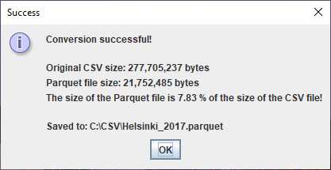

## CSV to Parquet Converter

A Java application designed to convert CSV files into Apache Parquet files

### But Why?

Nowadays, many companies and organizations share their data in CSV file format.
However, Apache Parquet file format would be better for several reasons:
- As Parquet stores data by column instead of row, similar data is grouped together, resulting in much better compression
- Parquet preserves data types (doubles, integers, strings, dates) while CSV treats everything as text
- Parquet offers significantly faster read performance by loading only necessary columns

### Solution

This CSV to Parquet Converter solves this problem as follows:
First, it asks the user for a CSV file as an input.
Then it validates the CSV file and if the file passes the validation, converts it into Parquet format.
Next, it does in-memory validation to validate the Parquet file it made.
If and only if the Parquet file passes the validation, the application writes the file in the same folder as the original CSV file.
(If a Parquet file with the same name exists already, user is asked if he/she wants the file to be overwritten.
Then the application displays the sizes of the files and tells in percentages the relative size of the Parquet file.

### Testing

I tested the application with City of Helsinki Purchase Data Set for the year of 2017 (availabe on avoindata.fi).
The result is very encouraging:

